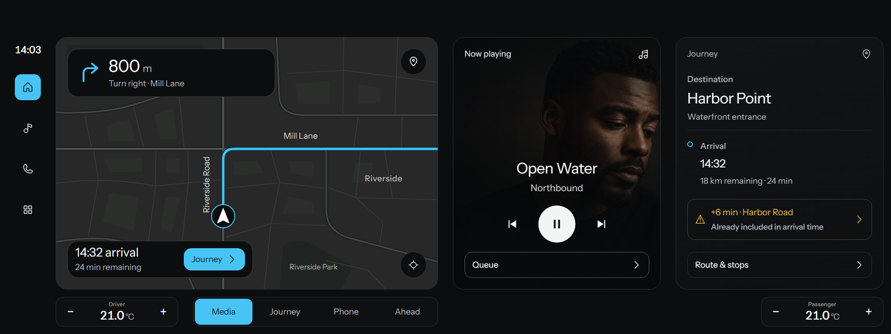
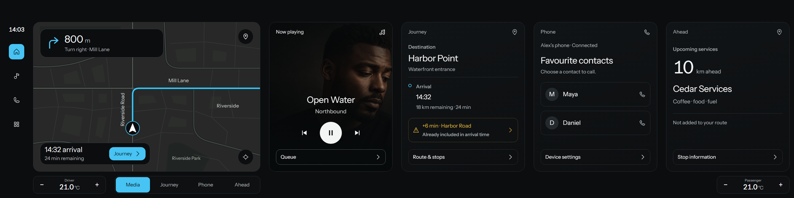
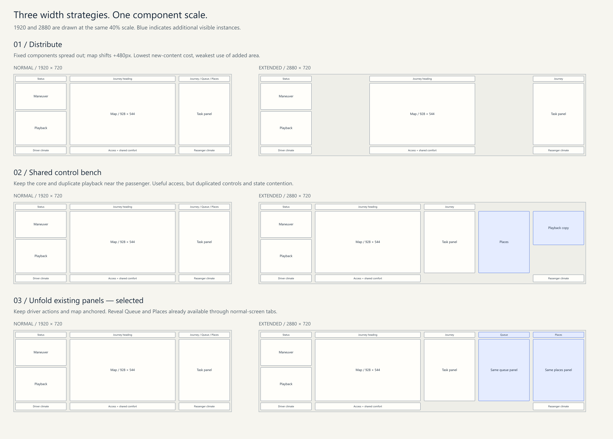
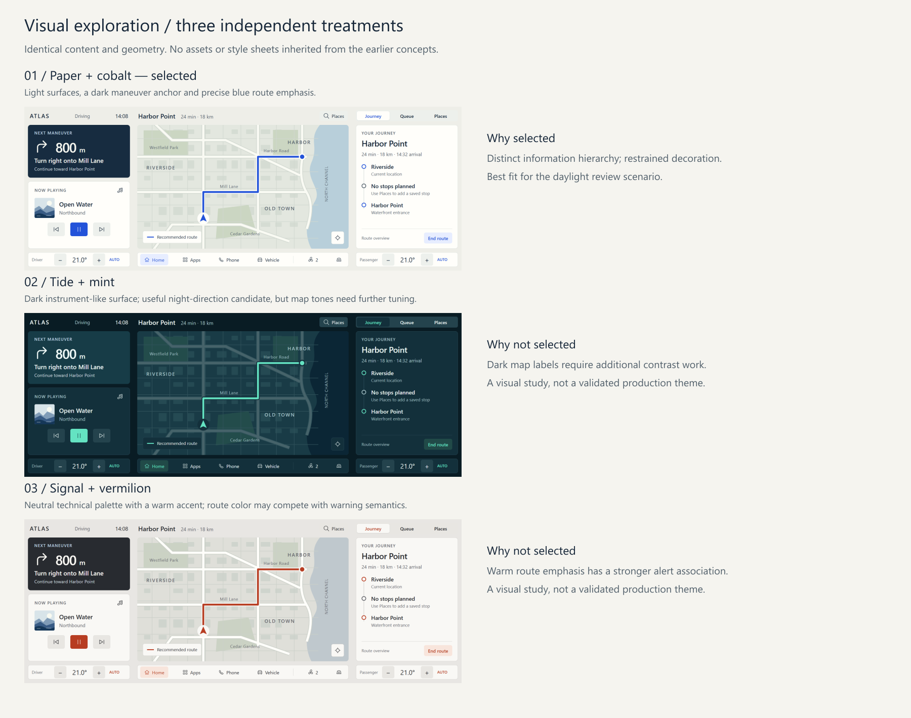
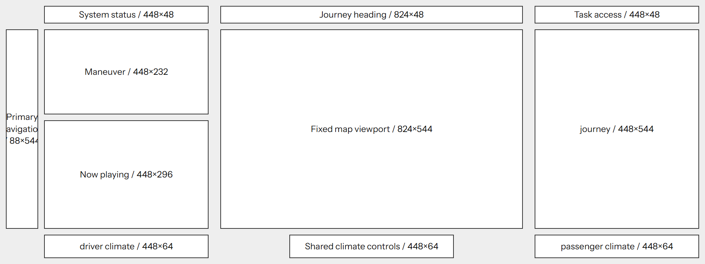
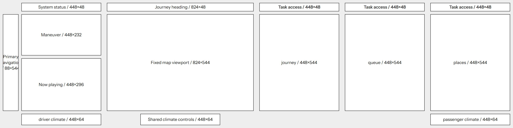
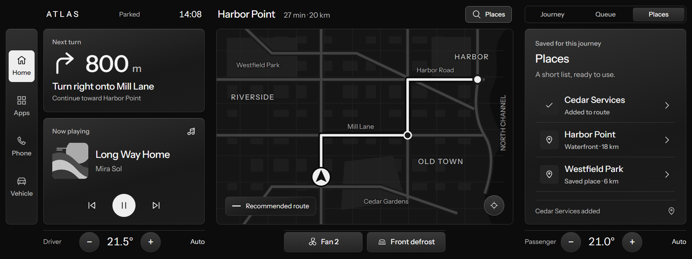
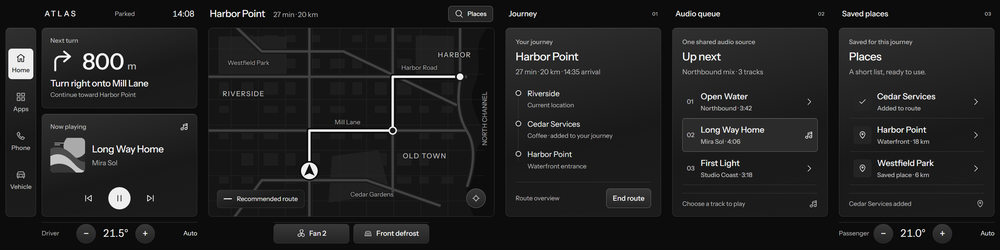

# ATLAS: A wider Home without larger components

**Final concept submission | 26 September 2026**

[Open the interactive prototype](prototype.html) · [Read the PDF](ATLAS-case-study.pdf)

## 1. A stable core. An open task area.

1920 shows one shared task panel. 2880 unfolds three. The map and frequent driver controls do not grow or drift.

*Final Home screens at the same presentation scale. The larger display exposes the existing Queue and Places panels; it introduces no exclusive application.*

## 2. The brief, translated into decisions

Deliver a concept explanation and visual documentation for one Home system at 1920 × 720 and 2880 × 720, with identical component dimensions and an economical implementation.

| Standing | Decision |
| --- | --- |
| Required by the slides | Two display configurations; shared component pixel geometry; explain IA, screen zoning, layout optimization and cost-conscious reuse. |
| Erika’s clarification | Widgets are acceptable. A growing map could work, but a fixed map is preferred. The additional area needs a purpose. |
| Chosen constraint | Keep the entire map viewport, widgets, headers, access controls and comfort groups fixed in width and height. |
| Working assumptions | Left-hand drive; added width to the right; separate instrument cluster; one journey and audio session; steering-wheel/physical volume and voice access assumed. |
| Scope | Home and a few illustrative states. No live routing, vehicle integration, passenger identification, full app suite or production validation. |
| Latest user direction | Start a fresh proposal. No previous layouts, visual styles, code assets or Figma kit assets are reused in this submission. |

The two display sizes are hardware profiles, not a continuously fluid web layout. Only the canvas, task-panel count and passenger comfort anchor change.

The attached early implementation guidance contains superseded style and layout prescriptions. It is treated as project history; the slides and later user decisions govern this proposal. Earlier files are preserved, not deleted.

## 3. What the process needed to change

Earlier exploration generated useful questions, but visual detail repeatedly arrived before the adaptation logic. This pass closes the structural decisions first.

| Step | Work completed | Decision produced |
| --- | --- | --- |
| 1. Reframe | Read the slide brief, existing guide and Erika’s response. Separate requirements from historical ideas. | The fixed component pair is the deliverable; style is a separate decision. |
| 2. Check evidence | Review OEM manuals, manufacturer publications, Apple guidance and standards scopes. | Borrow patterns, not unsupported claims of exact pixel reuse. |
| 3. Define Home | Assign persistence, access and conditional content; declare one comparison scenario. | Navigation + compact playback + persistent controls; detail lives in reusable panels. |
| 4. Compare mechanisms | Draw Distribute, Shared control bench and Unfold as paired block layouts. | Select Unfold for concurrency without moving the driver core. |
| 5. Explore visuals | Render the same new composition in Paper, Tide and Signal treatments. | Select Paper + cobalt for the daylight concept. |
| 6. Implement | One state store, geometry registry and shared renderer; build both hardware profiles. | No screen-specific application fork. |
| 7. Verify | Inspect actual pixel bounds, overflow, state persistence, access and representative states. | Deliver measured geometry evidence and clearly bounded claims. |

This is a designer-led concept evaluation, not a user study. No participant interviews, simulator sessions, measured glance tests or production cost estimates were conducted.

## 4. Research that changes the design

Industry precedents support the organization of functions. They do not prove our exact fixed-pixel solution.

| Evidence | Transfer into ATLAS | Limit |
| --- | --- | --- |
| Hyundai split screen [S1] | Existing functions can share a selectable secondary location. | Does not establish this two-size geometry. |
| BMW QuickSelect [S2] | Keep frequent activity access near the assumed driver. | No copied widget bar or unverified reach claim. |
| Volkswagen ID.7 [S3] | Separate persistent access/comfort from Home content. | Our controls are fixed groups, not stretching bars. |
| Apple vehicle integration [S4] | Separate the main task from adjacent functional regions. | CarPlay scaling/resizing is not borrowed. |
| Mercedes zero layer [S5] | Surface relevant content where it helps a task. | No AI recommendations or personalized prediction service. |
| NHTSA / ISO [S6-S8] | Treat distraction, dialogue and legibility as validation questions. | Public scopes are not certification; physical and driving tests remain. |

A community kit or cockpit photograph can illustrate styling and grouping but cannot establish production adaptation rules. No screenshot was used as proof of ergonomic performance.

The original minimum-IA question becomes a product decision: this Home supports staying oriented, controlling audio and comfort, and preparing the current journey. It does not need a permanent weather, profile or connected-phone card.

## 5. One inventory, different visibility

The normal configuration has the same functions. The extended configuration changes how much of them can be seen at once.

| Content / function | Home treatment | State rule |
| --- | --- | --- |
| Next maneuver | Fixed driver-side guidance component | Active route; becomes a destination entry point when no route is active. |
| Map | Fixed central 928 × 544 viewport | Same viewport in both sizes; schematic asset, no live map service. |
| Now playing | Compact fixed driver-side widget | Playing/paused and track changes; controls remain near the driver. |
| Journey / Queue / Places | Three existing 448 × 544 panels | One tab-selected panel at 1920; all three visible at 2880. |
| Phone | Persistent access, no permanent card | Connection and illustrative call view use the same task area. |
| Apps / Vehicle / Home | Fixed access dock | Tools replace the first task panel; Home restores Journey. |
| Comfort | Driver and passenger temperature groups plus shared fan/defrost | Always available; passenger group follows the right edge. |
| Weather / profile / rich notifications | Excluded from this concept | Not needed for the defined tasks; no filler to justify width. |

Scenario for comparison: an active journey to Harbor Point, one shared music queue and saved places. The map and all names/data are illustrative.

No predictive “context slot” is required. Places is explicitly saved content, and Journey accurately reports either no stops or the selected stop. This avoids a relevance engine and an arbitrary fallback card.

## 6. Three spatial hypotheses

*Each pair uses the same scale. The alternatives are structural studies, not independently implemented products. Their consequences are evaluated on the next page.*

## 7. Why Unfold wins this brief

| Criterion | Distribute | Shared control bench | Unfold · selected |
| --- | --- | --- | --- |
| Fixed component dimensions | Pass | Pass | Pass |
| Driver-relative consistency | Map and its access move +480px | Core stays fixed | Seven core components stay fixed |
| Use of +960px | Mostly separation; little new task value | Passenger-side shared access | Concurrent existing panels |
| Added behavior | Few new states | Duplicate playback controls need consistent feedback | Visibility rule and panel focus/recovery |
| Reuse | High; same instances | Shared components, more duplicate instances | Same panel views already available at 1920 |
| Main risk | Space appears unearned; driver search shifts | Ambiguous control ownership / contention | More visible information; far-right reach unvalidated |
| Decision | Reject for weak width benefit | Keep as context-dependent alternative | Select for clear task benefit and bounded implementation |

Unfold is still a visibility strategy. Its argument is not “more widgets are innovative”; it is that existing full task panels no longer compete for one slot. No exclusive weather, entertainment or passenger service is introduced to fill space.

A parked walkthrough illustrates the benefit: starting at Journey, choose a queued track, add the saved Cedar stop, then review Journey. Normal: 5 interface activations including three tab switches. Extended: 2 activations with Journey still visible. This is an interface-action count, not a measured safety, speed or usability improvement.

The narrower Home remains complete. Content was not removed from it to manufacture a premium-screen advantage.

## 8. A new visual language, tested three ways

*Paper + cobalt is selected. Tide + mint and Signal + vermilion remain visual studies using identical content and component dimensions; they are not validated day/night modes.*

## 9. A layout contract, not two mockups

A 480px horizontal pitch makes +960px exactly two additional task locations. Modules keep 16px outer margins and 32px separation between pitch groups.

| Component | Bounds | 1920 position | 2880 position |
| --- | --- | --- | --- |
| Status | 448 × 48 | 16,16 | 16,16 |
| Maneuver | 448 × 232 | 16,80 | 16,80 |
| Now playing | 448 × 296 | 16,328 | 16,328 |
| Map heading | 928 × 48 | 496,16 | 496,16 |
| Map viewport | 928 × 544 | 496,80 | 496,80 |
| Task panel | 448 × 544 | 1456,80 (selected view) | 1456 / 1936 / 2416,80 |
| Task header | 448 × 48 | 1456,16 (tabs) | 1456 / 1936 / 2416,16 (titles) |
| Driver climate | 448 × 64 | 16,640 | 16,640 |
| Passenger climate | 448 × 64 | 1456,640 | 2416,640 |
| Access / shared comfort | 928 × 64 | 496,640 | 496,640 |

Horizontal equation: 480 driver region + 960 map region + (1 or 3) × 480 task regions = 1920 or 2880. Vertical equation: 16 margin + 48 header + 16 gap + 544 content + 16 gap + 64 controls + 16 margin = 720.

Task headers have two presentation states, tabs and title-only, at the same bounds. These are an explicit layout-dependent variation, not hidden resizing. The dock and status are fixed components; no full-width header or footer is stretched.

Passenger climate moves 960px with the passenger-side edge. That assumes rightward physical extension; it is not evidence of physical passenger reach. Empty lower space under the additional panels separates infrequent detail from persistent controls rather than adding new controls.

## 10. The selected structure at both sizes

*Normal and extended wireframes use the same presentation scale. These images come directly from the implemented component bounds, with decorative content suppressed.*

## 11. States stay coherent across the pair

The prototype demonstrates the layout argument with a deliberately small set of interactions.

| Situation | Response | Reuse / engineering consequence |
| --- | --- | --- |
| Switch display profile | Keep journey, queue, playback, temperatures and connection state. | State store is independent from visible panel instances. |
| Switch normal-screen tabs | Replace only the secondary panel; map and driver controls stay visible. | Same renderer used when that panel is visible at 2880. |
| Choose a place / queued track | Allowed while parked; disabled during the on-route scenario. | One availability rule for both sizes; no passenger detection. |
| End route | Hide the route and update maneuver, map heading and Journey. | Geometry stays unchanged. |
| Open Phone / Vehicle / Apps | Replace the first task panel; Home recovers the default overview. | No separate full-screen application layouts in this concept. |
| Change playback / comfort | Immediate local state update in the existing control. | One audio session and shared vehicle settings. |

Working controls include play/pause/skip, saved stop add/remove, route start/end, temperature changes, fan, defrost and illustrative phone connection/call states.

The map is schematic and static. Recenter confirms the already centered position; no live routing, map pan/zoom engine, real phone call, voice recognition or vehicle command is performed. Two saved-place entries show a preview notice; only Cedar Services changes the illustrative route. These are prototype limits, not completed integrations.

## 12. More space, the same underlying state

*Parked scenario: Cedar Services is added, Long Way Home is playing and driver temperature is 21.5°. Those same values persist when changing the display profile.*

## 13. A useful extension has a cost

Reuse reduces variation; it does not eliminate the cost of showing additional views.

| Area | Implementation in this prototype | Production implication |
| --- | --- | --- |
| Top-level geometry | 9 registered component types; 10 default instances at 1920, 14 at 2880. | Four extra instances: two task headers and two task panels; no new wide-only component type. |
| Content views | Journey, Queue, Places, Phone, Vehicle and Apps use the same fixed task frame. | Shared dimensions do not make these six bodies identical; each needs content/state tests. |
| Assets | One authored map SVG and one authored album illustration; shared icon definitions. | One map resource/render target in both profiles; real SDK performance still untested. |
| State | One store for route, media, comfort and connection. | A vehicle implementation needs service synchronization, error handling and lifecycle management. |
| Layout rules | Two hardware profiles; panel visibility; fixed anchors; right-anchored passenger climate; header presentation. | Configuration logic stays at the layout boundary. No per-widget width breakpoints. |
| Rendering | Simple full DOM render on state changes, appropriate to this demonstration. | Production should use targeted updates and retain renderer/service lifecycles. |
| QA | Shared component/state checks plus profile-specific bounds, focus and simultaneous-view checks. | Reused components still require testing in both compositions. |

There are no estimated percentage savings. The defensible claim is a smaller variation surface than separate dashboards with resized map, compact/expanded widget bodies and exclusive passenger applications.

Additional mounted views still increase rendering work and simultaneous data presentation. The most economical design is not automatically the least populated one; the selected concept trades a small, explicit presentation cost for concurrent access.

## 14. What was verified, and what was not

The delivered prototype passes its structural and representative interaction checks. Human-factors performance remains a hypothesis.

| Check | Evidence / result |
| --- | --- |
| Native dimensions | Screenshots and browser bounds: exactly 1920 × 720 and 2880 × 720. |
| Complete component reuse | Every mounted top-level component matches the shared geometry registry. |
| Anchor consistency | Seven core components preserve x, y, width and height. The first 1440 × 720 rendered pixels are identical in both default screenshots. |
| Content fit | No top-level component overflow in 48 representative content configurations. No overlapping components or out-of-canvas bounds in either default composition. |
| State persistence | Stop, selected track and driver temperature survive profile changes; playback and route toggles verified. |
| Availability / recovery | Queue and place editing disabled on route; enabled parked. Home, disconnected phone and route-ended states checked. |
| Visual review | Both final screens, three treatments, wireframes and representative state captures inspected. |
| Unvalidated | Physical reach, glare, PPI, glance behavior, driver workload, localization, vehicle performance and legal/standards compliance. |
| Task walkthrough | The automated parked sequence takes 5 activations at 1920 and 2 at 2880. This is a counted interaction sequence, not a user-performance result. |

NHTSA guidance [S6] concerns distraction evaluation. ISO 15005 [S7] addresses dialogue, and ISO 15008 [S8] addresses specified visual presentation aspects. Their existence is not evidence this prototype meets them.

The largest unresolved product risk is whether two extra detail panels remain useful enough during a moving journey. Parked concurrency is demonstrated; actual driving benefit is not. If vehicle packaging puts the rightmost area out of useful view, this concept would need reassessment rather than a passenger label as justification.

## 15. Deliverables and final recommendation

Recommend ATLAS / Unfold as the submission concept: a stable driving core with concurrent shared task panels on the extended display.

| Slide requirement | Delivered evidence |
| --- | --- |
| Concept explanation | This case study: IA, zone responsibilities, alternative arguments, chosen mechanism, engineering limits and evaluation. |
| Screen zoning and layout optimization | Three paired zoning hypotheses, selected wireframes, exact component coordinates and adaptation rules. |
| Home wireframes at both sizes | wireframe-1920.png and wireframe-2880.png. |
| Home prototypes at both sizes | prototype.html with both hardware profiles and shared interactive state. |
| Visual documentation | home-1920.png, home-2880.png, visual-exploration.png, zoning-alternatives.png and state captures. |
| Implementation/reuse evidence | prototype.js geometry registry, shared CSS and verification.json. |
| Process and research record | case-study.md, case-study.html, this PDF and linked primary sources. |

The final decision is provisional only in the product-development sense: it is the recommended answer to the exercise, not a certified production HMI. The required concept and two-size prototype deliverables are complete.

Next in a real program: confirm vehicle packaging and hardware controls, evaluate representative tasks in a cockpit/simulator, then integrate live vehicle and infotainment services. Those are external validation steps rather than missing work needed to explain this thought-project solution.

## 16. Sources and evidence boundaries

*Accessed 26 September 2026. OEM examples support patterns; none is presented as proof of this exact geometry. ISO references use public scope descriptions, not a paid full-standard audit.*

- **[S1] [Hyundai - Basic operation and split screen](https://webmanual.hyundai.com/STD_GEN5W/AVNT2/EU/English/basicoperation.html)** — A selectable secondary pane can show different existing functions. This supports reusable panel access, not identical pixel dimensions across models.
- **[S2] [BMW - Operating System 8.5 / QuickSelect](https://www.press.bmwgroup.com/global/article/attachment/T0442333EN/620071)** — BMW describes a driver-side widget bar and direct function access beside a large selected view. This supports protecting frequent access near the driver.
- **[S3] [Volkswagen - ID.7 interior concept and technologies](https://www.volkswagen-newsroom.com/en/the-volkswagen-id7-17897/id7-interior-concept-and-technologies-17899)** — Persistent access and comfort layers surround variable Home tiles. Their responsibilities can be separated without copying full-width bars.
- **[S4] [Apple - Optimize CarPlay for vehicle systems (WWDC23)](https://developer.apple.com/videos/play/wwdc2023/10150/)** — CarPlay occupies an allocated view area and can coexist with native UI. Dynamic resizing is available; that mechanism is not compatible with this project’s strict fixed map.
- **[S5] [Mercedes-Benz - MBUX reaches a new level](https://group.mercedes-benz.com/technology/digitalisation/connectivity/mbux-interior-assist.html)** — Relevant functions can be surfaced at the top level. ATLAS uses explicit saved data and deterministic states, not a new prediction system.
- **[S6] [NHTSA - Final visual-manual distraction guidelines (2013)](https://www.transportation.gov/regulations/federal-register-documents/2013-09883)** — Voluntary guidelines assess visual-manual secondary tasks. A screen image or pixel-level test cannot demonstrate distraction compliance.
- **[S7] [ISO 15005:2017 - Dialogue management](https://www.iso.org/standard/69238.html)** — Public scope concerns driver-system dialogue and verification conditions. Used to frame interaction consistency; the full standard was not audited.
- **[S8] [ISO 15008:2017 - In-vehicle visual presentation](https://www.iso.org/standard/62784.html)** — Public scope covers dynamic visual information and legibility; maps/topographic representations are explicitly excluded from its scope. No blanket map-compliance claim is made.

## Reproducibility and ownership

Prototype, illustrations, layout studies and report were authored for this exercise. No previous project CSS, bitmap reference, third-party UI kit or OEM asset was copied into the final implementation. Historical research informed the problem framing. Public sources are cited for their documented patterns.

The browser prototype runs offline from `prototype.html`. Its CSS defines the three visual treatments; its JavaScript exposes a shared geometry registry and single state store. The selected export is Paper + cobalt. The presenter controls sit outside the vehicle canvas.
